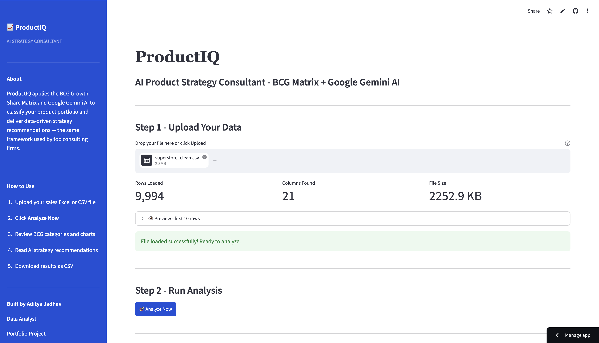
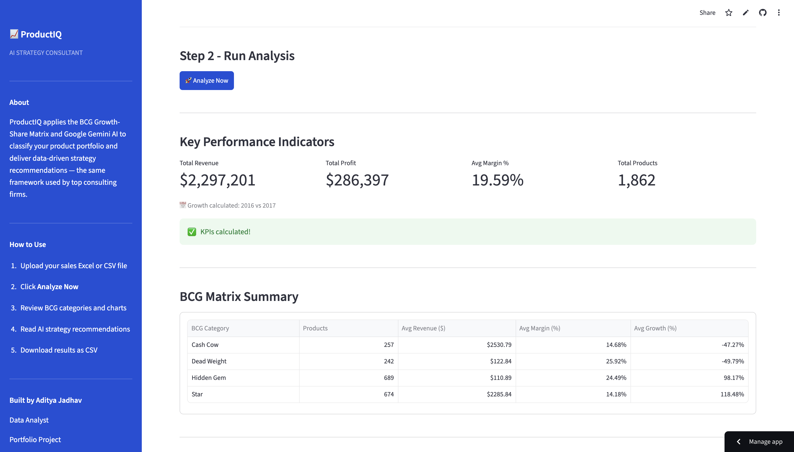
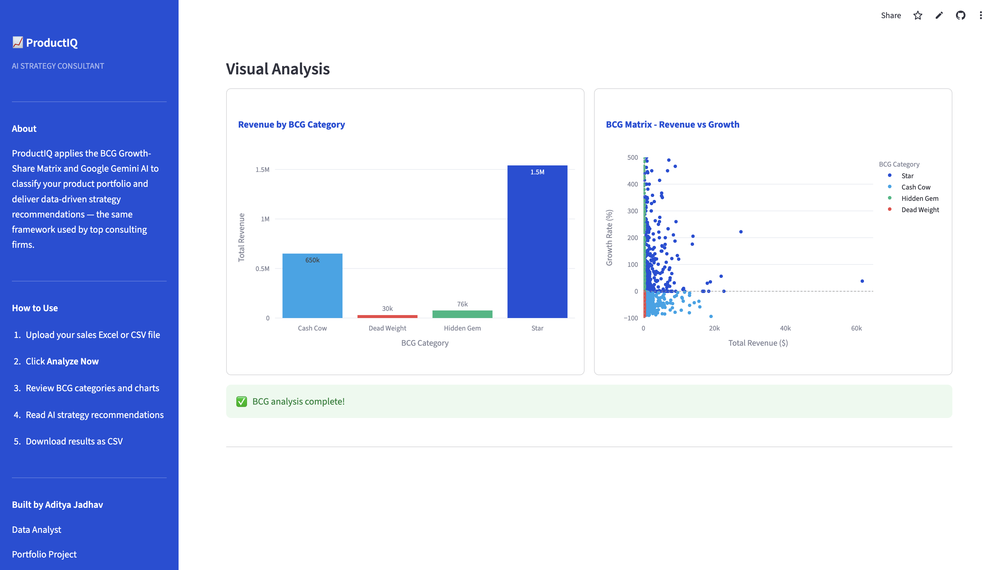
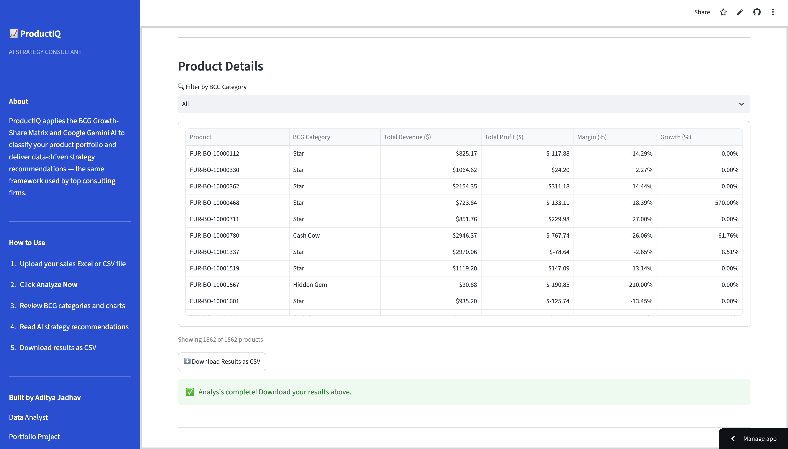
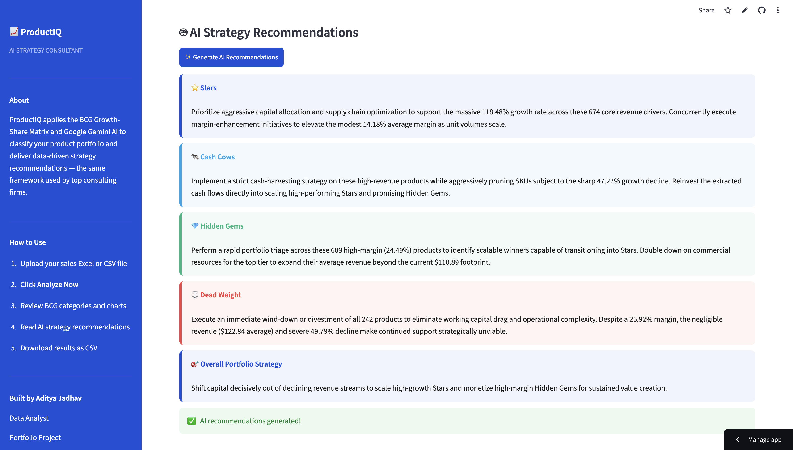

# 📈 ProductIQ - AI Product Strategy Consultant

> BCG Matrix Analysis + Google Gemini AI Strategy Recommendations

🔗 **Live Demo:** [aistrategyconsultant.streamlit.app](https://aistrategyconsultant.streamlit.app)

---

## What is ProductIQ?

ProductIQ is an AI-powered product portfolio analyzer that applies the **BCG Growth-Share Matrix** framework - used by top consulting firms like McKinsey, BCG, and Bain - to classify products and generate data-driven strategy recommendations using **Google Gemini AI**.

Upload any sales dataset and get instant insights in seconds.

---

## Screenshots

---

## Features

- 📊 **BCG Matrix Classification** - Auto-classifies products as Star, Cash Cow, Hidden Gem, or Dead Weight
- 📈 **Visual Analysis** - Revenue bar chart + BCG scatter plot
- 🤖 **AI Strategy Recommendations** - Powered by Google Gemini AI
- 🔍 **Product Filter Table** - Filter by BCG category with CSV download
- 📁 **Supports CSV & Excel** - Auto-detects product, sales, profit, date columns

---

## Tech Stack

| Tool | Purpose |
|------|---------|
| Python | Core language |
| Streamlit | Web app framework |
| Pandas | Data processing |
| Plotly | Interactive charts |
| Google Gemini AI | AI recommendations |

---

## Built By

**Aditya Jadhav** - Data Analyst  
📧 corp.adi07@gmail.com  
🔗 [GitHub](https://github.com/theadityajadhav)
